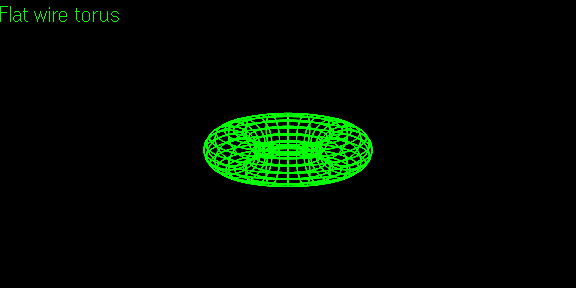
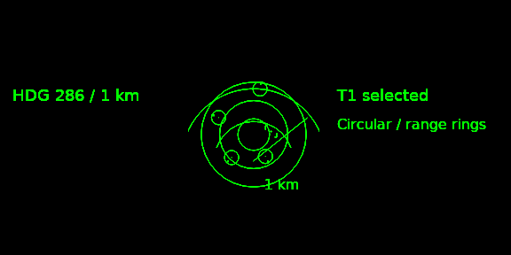
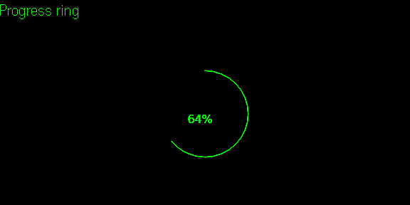
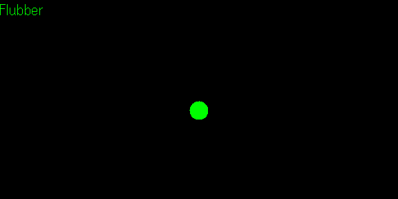
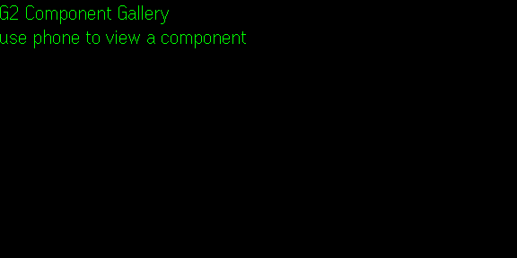

# G2 Component Gallery

Try 390 display components on your Even Realities G2 glasses. Browse the categories on your phone, tap a component, and adjust its appearance on the glasses.

This is the public project tracker, user guide and screenshot gallery. Use [Issues](https://github.com/homeauto-git/g2-component-gallery/issues) to report a problem or suggest a component. SDK/runtime source and distributable packages are not included in this tracker.

## How to use it

1. Open G2 Component Gallery in Even with your glasses connected.
2. The glasses show the app name and “use phone to view a component”. Nothing is selected automatically.
3. Browse a category on your phone and tap a drawing to show that component on the glasses.
4. Open **Component options** to change its size, position, text and appearance.
5. Use **Theme**, **Variant** and **Animate** to compare looks or pause the display.
6. Choose **HUD scenes** for complete layouts or **Companions** for animated characters and Flubber.

Readings in the examples are sample data, not live sensor readings. You do not need to write code to browse the gallery.

## What you can explore

- Frames, brackets and reticles.
- Progress rings, gauges, meters and readouts.
- Compass, navigation, radar and map-style layouts.
- Status, communication, notification and control elements.
- Procedural wireframes, icons and decoration.
- Complete HUD scenes and animated companions.

Developers can use the gallery to compare components and see what fits before adding them to a G2 application.

## Screenshots

These are actual native simulator captures of the app's glasses display, not phone screenshots or generated mockups. Each image is 576 × 288. The transparent display was composited over black for readability here; the original native captures are retained in the local verification records. Simulator captures are not evidence of physical-glasses readability or performance.

### Wireframe

### Radar scene

### Progress ring

### Flubber

### First launch

## Report a problem

[Open a bug report](https://github.com/homeauto-git/g2-component-gallery/issues/new?template=bug-report.yml). Include:

- What you selected and changed on the phone.
- What you expected and what appeared on the glasses.
- App version, phone model/OS, Even app version and glasses firmware, if known.
- Steps to reproduce and a screenshot, if possible.

Do not post account passwords, API keys, invitation links, private notifications or other personal information. A simulator-only problem should be marked as such.

For a new component or usability idea, [open a feature request](https://github.com/homeauto-git/g2-component-gallery/issues/new?template=feature-request.yml).

## License and attribution

Original project code and documentation use the MIT license. Third-party material and supplied character artwork retain their own terms; see **License & attribution** inside the app. This tracker does not include those character packs, research archives, credentials or packaged app binaries.

This is an independent third-party project, not an official Even Realities SDK or an endorsement by Even Realities.
